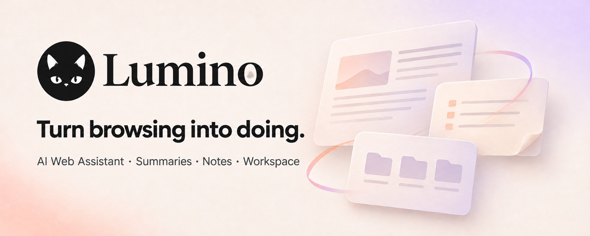

# Lumino - AI Web Assistant, Summaries & Notes

[简体中文](README.md) · English

> Turn what you browse into work you can keep.

Lumino brings one AI assistant, a file workspace and reusable task shortcuts into your browser side panel.



## Features

- Summarize pages, compare tabs, collect designs and perform browser actions through one assistant.
- Reference pages and files with clickable chips; return to the original tab or preview a workspace file.
- Upload, save, search, sort, preview, edit and export files with icon and list views.
- Organize uploads, downloads, favorites, screenshots, notes and projects in dedicated folders.
- Save instructions as reusable shortcuts, started manually when you need them.
- Search conversations and collapse date groups; inspect or collapse tool execution details.
- Optionally connect a compatible Obsidian MCP service.
- New installations follow Chrome’s interface language: Chinese variants use Simplified Chinese, and other languages use English. Manual choices and existing preferences are preserved.

## Install

[Chrome Web Store](https://chromewebstore.google.com/detail/pgmojincedjeggjgfafpkbmloiiinplj)

To install a packaged ZIP manually, extract it, enable Developer mode in `chrome://extensions`, and choose **Load unpacked**.

```bash
git clone https://github.com/the-invulnus/lumino.git
cd lumino
pnpm install
pnpm build
```

Load `build/chrome-mv3-prod/`. Use `pnpm dev` with `build/chrome-mv3-dev/` for development, or `pnpm package` to create `build/chrome-mv3-prod.zip`.

## Configure

Set an OpenAI-compatible endpoint, API key and a model supporting tool calling in the extension settings. Open the side panel, reference pages or files and describe your task. Lumino does not include model access; charges and availability depend on your provider. Obsidian requires a separate compatible MCP service.

## Privacy

Credentials are stored in Chrome local storage, conversations in IndexedDB and files in OPFS. Relevant messages, page content, screenshots or file excerpts may be sent to your configured model provider or enabled Obsidian service to perform your requests. Lumino does not send them to developer-operated servers and has no advertising or behavioral analytics. Theme preferences and legacy custom-agent settings may use Chrome sync storage.

Read the [privacy policy](PRIVACY.md). Export files you need before uninstalling.

## Development

Plasmo · React 18 · TypeScript · Vitest · IndexedDB / OPFS

```bash
pnpm test
pnpm exec tsc --noEmit
pnpm package
```

Release copy and artwork: [marketing](marketing/README.md).

MIT © 2026 [the invulnus](https://github.com/the-invulnus)
